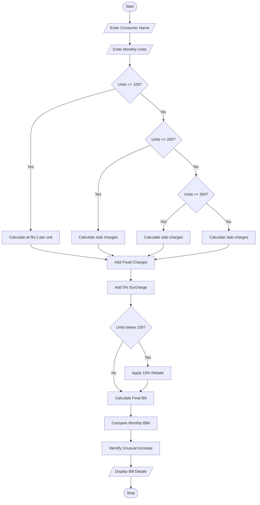

## 1. Problem Statement

 Progressive Electricity Billing: Calculate household bills using multiple consumption slabs, fixed charges, surcharges, and rebates, then compare bills across several months and identify unusual increases. 
## 2. Algorithm

**Step 1:** Start the program.

**Step 2:** Enter the consumer's name.

**Step 3:** Enter electricity consumption in units for three months.

**Step 4:** Calculate electricity charges using the following slabs:

| Units     | Rate per unit |
| --------- | ------------: |
| 0–100     |            ₹2 |
| 101–200   |            ₹3 |
| 201–300   |            ₹5 |
| Above 300 |            ₹7 |

**Step 5:** Add fixed charges of ₹50.

**Step 6:** Add a 5% surcharge.

**Step 7:** Apply a 10% rebate if consumption is below 100 units.

**Step 8:** Calculate the final bill.

**Step 9:** Compare monthly bills and identify unusual increases.

**Step 10:** Display the final bills and stop.

## 3. Flowchart 




## 4. Sample Input

```text
ELECTRICITY BILL CALCULATOR

Enter Consumer Name: Sai Teja

Month 1
Enter electricity units: 80

Month 2
Enter electricity units: 150

Month 3
Enter electricity units: 280
```

## 5. Sample Output

```text
ELECTRICITY BILL CALCULATOR

Enter Consumer Name: Sai Teja

Month 1
Electricity Bill: Rs. 196.65

Month 2
Electricity Bill: Rs. 473.75

Month 3
Electricity Bill: Rs. 1207.5

MONTHLY BILL COMPARISON

Month 1 : 196.65
Month 2 : 473.75
Month 3 : 1207.5

Unusual increase detected in Month 2
Unusual increase detected in Month 3

Thank You!
```

