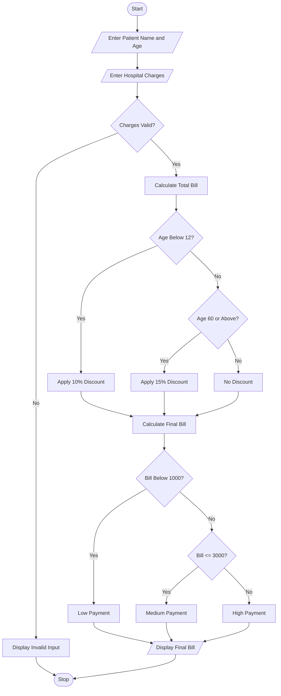

## 1. Problem Statement
Hospital Billing and Patient Classification: Process consultation, diagnostic, and treatment charges, apply conditional concessions, validate billing constraints, and classify patients according to a supplied payment policy. 

## 2. Algorithm

**Step 1:** Start the program.

**Step 2:** Enter patient name and age.

**Step 3:** Enter consultation, diagnostic, and treatment charges.

**Step 4:** Check whether the entered charges are valid.

**Step 5:** Calculate the total bill.

**Step 6:** Apply concessions:

* Age below 12 → 10% discount.
* Age 60 and above → 15% discount.
* Other ages → No discount.

**Step 7:** Calculate the final bill.

**Step 8:** Classify the patient:

* Below ₹1,000 → Low Payment.
* ₹1,000 to ₹3,000 → Medium Payment.
* Above ₹3,000 → High Payment.

**Step 9:** Display the final bill and classification.

**Step 10:** Stop.

## 3. Flowchart 




## 4. Sample Input

```text
HOSPITAL BILLING SYSTEM

Enter Patient Name: Sai Teja
Enter Patient Age: 65

Enter Consultation Charges: 500
Enter Diagnostic Charges: 1000
Enter Treatment Charges: 3000
```

## 5. Sample Output

```text
----- HOSPITAL BILL -----

Patient Name: Sai Teja
Patient Age: 65

Total Bill: Rs. 4500.0
Discount: Rs. 675.0
Final Bill: Rs. 3825.0

Patient Classification: High Payment

Thank You!
```


