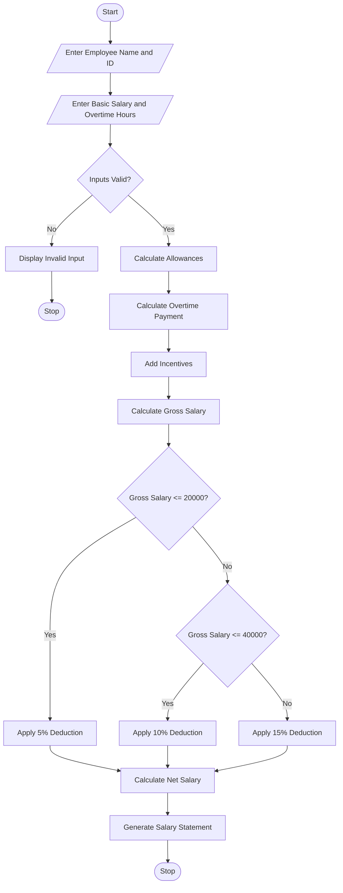

## 1. Problem Statement
Employee Payroll and Deduction Analysis: Calculate gross salary from basic pay, allowances, overtime, and incentives; apply progressive deductions and generate a formatted salary statement. 

## 2. Algorithm

**Step 1:** Start the program.

**Step 2:** Enter employee name and employee ID.

**Step 3:** Enter basic salary and overtime hours.

**Step 4:** Calculate allowances.

Allowances = Basic Salary × 20%

**Step 5:** Calculate overtime payment.

Overtime Payment = Overtime Hours × 200

**Step 6:** Add incentives.

**Step 7:** Calculate gross salary.

Gross Salary = Basic Salary + Allowances + Overtime + Incentives

**Step 8:** Apply progressive deductions.

* Salary up to ₹20,000 → 5%.
* Salary up to ₹40,000 → 10%.
* Salary above ₹40,000 → 15%.

**Step 9:** Calculate net salary.

Net Salary = Gross Salary − Deduction

**Step 10:** Display the formatted salary statement.

**Step 11:** Stop the program.

## 3. Flowchart 




## 4. Sample Input

```text
EMPLOYEE PAYROLL SYSTEM

Enter Employee Name: Sai Teja
Enter Employee ID: 101

Enter Basic Salary: 25000
Enter Overtime Hours: 10
```

## 5. Sample Output

```text
----- SALARY STATEMENT -----

Employee Name: Sai Teja
Employee ID: 101

Basic Salary: Rs. 25000.0
Allowances: Rs. 5000.0
Overtime Payment: Rs. 2000.0
Incentives: Rs. 1000.0

----------------------------
Gross Salary: Rs. 33000.0
Deduction: Rs. 3300.0
Net Salary: Rs. 29700.0

----------------------------
Salary Calculated Successfully!
```
