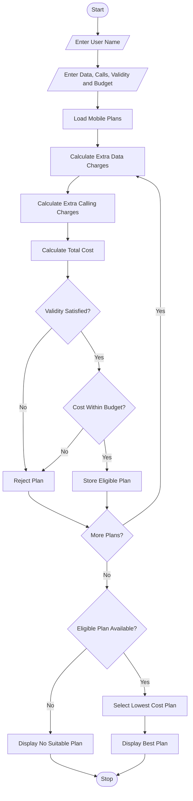

## 1. Problem Statement
Multi-Plan Telecommunications Cost Optimization: Evaluate several mobile plans against usage, validity, and budget constraints; calculate excess charges and identify the most economical eligible plan. 

## 2. Algorithm

**Step 1:** Start the program.

**Step 2:** Enter the user's name.

**Step 3:** Enter required data usage, calling minutes, validity, and budget.

**Step 4:** Create a list of available mobile plans.

**Step 5:** Calculate additional data charges.

**Step 6:** Calculate additional calling charges.

**Step 7:** Calculate the total plan cost.

Total Cost = Plan Price + Extra Data Charges + Extra Calling Charges

**Step 8:** Check whether the plan satisfies the required validity.

**Step 9:** Check whether the total cost is within the user's budget.

**Step 10:** Select the eligible plan with the lowest total cost.

**Step 11:** Display the most economical plan.

**Step 12:** Stop the program.

## 3. Flowchart 



## 4. Sample Input

```text
MOBILE PLAN COST OPTIMIZATION

Enter Your Name: Sai Teja

Enter Required Data (GB): 8
Enter Required Calling Minutes: 800
Enter Required Validity Days: 28
Enter Your Budget: 500
```

## 5. Sample Output

```text
----- MOBILE PLAN RESULT -----

Customer Name: Sai Teja

Best Plan: Premium

Plan Cost: Rs. 399
Extra Data Charges: Rs. 0
Extra Calling Charges: Rs. 0

Total Cost: Rs. 399

Thank You!
```

