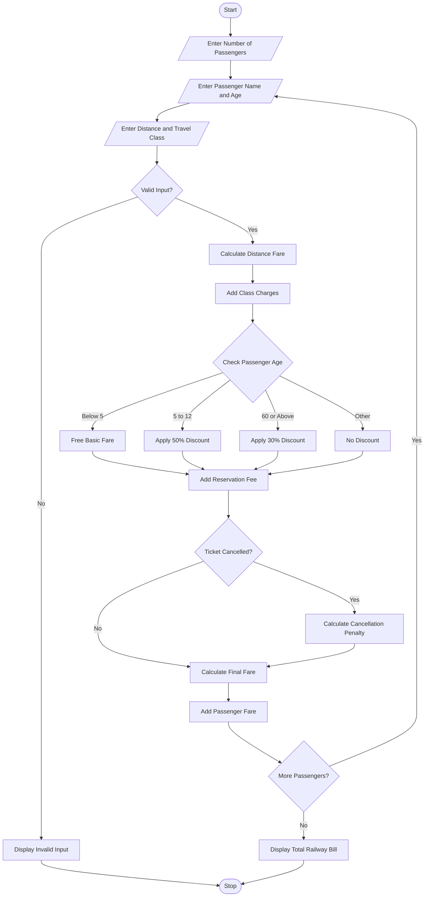

## 1. Problem Statement
Railway Fare and Reservation Calculator: Calculate fares for multiple passengers using distance slabs, travel classes, age-based concessions, reservation fees, and specified cancellation penalties. 

## 2. Algorithm

**Step 1:** Start the program.

**Step 2:** Enter the number of passengers.

**Step 3:** Enter passenger name and age.

**Step 4:** Enter travel distance in kilometres.

**Step 5:** Select travel class.

**Step 6:** Calculate basic fare using distance slabs.

**Step 7:** Add travel class charges.

**Step 8:** Apply age-based concessions.

**Step 9:** Add reservation fees.

**Step 10:** Calculate the final ticket fare.

**Step 11:** Ask whether the ticket is cancelled.

**Step 12:** If cancelled, calculate the cancellation penalty.

**Step 13:** Calculate the total fare for all passengers.

**Step 14:** Display the railway ticket bill.

**Step 15:** Stop the program.

## 3. Flowchart 


## 4. Sample Input

```text
RAILWAY FARE CALCULATOR

Enter Number of Passengers: 2

Passenger 1

Enter Passenger Name: Sai
Enter Age: 25
Enter Distance in KM: 200

1. Sleeper
2. AC 3 Tier
3. AC 2 Tier

Select Travel Class: 1
Cancel Ticket? (yes/no): no

Passenger 2

Enter Passenger Name: Ravi
Enter Age: 65
Enter Distance in KM: 200

1. Sleeper
2. AC 3 Tier
3. AC 2 Tier

Select Travel Class: 2
Cancel Ticket? (yes/no): no
```

## 5. Sample Output

```text
----- PASSENGER BILL -----

Passenger Name: Sai
Age: 25
Distance: 200 KM
Travel Class: Sleeper
Final Fare: Rs. 670.0

Ticket Confirmed

----- PASSENGER BILL -----

Passenger Name: Ravi
Age: 65
Distance: 200 KM
Travel Class: AC 3 Tier
Final Fare: Rs. 580.0

Ticket Confirmed

===== RAILWAY BILL =====

Total Passengers: 2
Total Railway Amount: Rs. 1250.0

Thank You!
```

