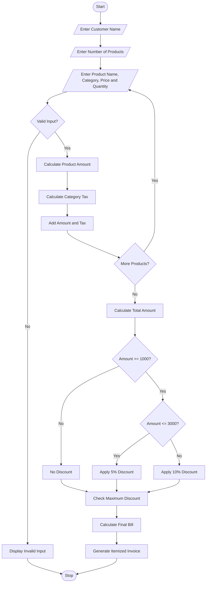

## 1. Problem Statement
Retail Billing with Multiple Discount Rules: Process multiple products, quantities, categoryspecific taxes, threshold discounts, and maximum concession limits to generate an itemized invoice. 
   
## 2. Algorithm

**Step 1:** Start the program.

**Step 2:** Enter the customer name.

**Step 3:** Enter the number of products.

**Step 4:** Enter product name, category, price, and quantity.

**Step 5:** Calculate the price of each product.

Product Amount = Price × Quantity

**Step 6:** Calculate category-specific tax.

**Step 7:** Calculate the total purchase amount.

**Step 8:** Apply discount based on purchase amount.

* Below ₹1,000 → No discount.
* ₹1,000–₹3,000 → 5% discount.
* Above ₹3,000 → 10% discount.

**Step 9:** Check the maximum discount limit of ₹500.

**Step 10:** Calculate the final bill.

**Step 11:** Display the itemized invoice.

**Step 12:** Stop the program.

## 3. Flowchart




## 4. Sample Input

```text
RETAIL BILLING SYSTEM

Enter Customer Name: Sai Teja

Enter Number of Products: 3

Product 1
Enter Product Name: Rice
Enter Category: food
Enter Product Price: 500
Enter Quantity: 2

Product 2
Enter Product Name: Mobile
Enter Category: electronics
Enter Product Price: 10000
Enter Quantity: 1

Product 3
Enter Product Name: Shirt
Enter Category: clothing
Enter Product Price: 1000
Enter Quantity: 2
```

## 5. Sample Output

```text
===== RETAIL INVOICE =====

Customer Name: Sai Teja

Product 1:
Product: Rice
Amount: 1000
Tax: 50
Product Total: 1050

Product 2:
Product: Mobile
Amount: 10000
Tax: 1800
Product Total: 11800

Product 3:
Product: Shirt
Amount: 2000
Tax: 240
Product Total: 2240

--------------------------

Total Amount: Rs. 15090.00
Discount: Rs. 500.00
Final Bill: Rs. 14590.00

==========================
Thank You! Visit Again!
```
