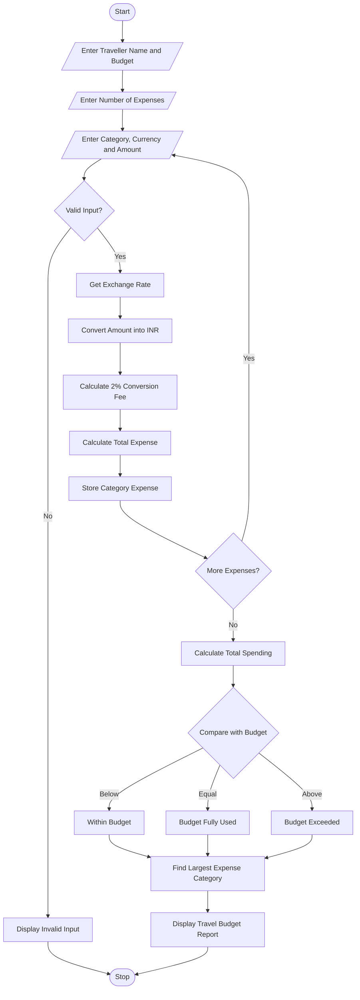

## 1. Problem Statement
Multi-Currency Travel Budget Analysis: Convert travel expenses using supplied exchange rates, incorporate conversion fees, compare planned spending against a budget, and identify the largest expense category. 

## 2. Algorithm

**Step 1:** Start the program.

**Step 2:** Enter traveller's name.

**Step 3:** Enter the total travel budget in INR.

**Step 4:** Enter the number of expense categories.

**Step 5:** Enter expense category, currency, and amount.

**Step 6:** Check the supplied exchange rate.

**Step 7:** Convert foreign currency into INR.

Converted Amount = Foreign Amount × Exchange Rate

**Step 8:** Calculate conversion fee.

Conversion Fee = Converted Amount × 2%

**Step 9:** Calculate total expense.

Total Expense = Converted Amount + Conversion Fee

**Step 10:** Add all category expenses.

**Step 11:** Compare total expenses with the travel budget.

**Step 12:** Identify the largest expense category.

**Step 13:** Display the travel budget report.

**Step 14:** Stop the program.

## 3. Flowchart 




## 4. Sample Input

```text
MULTI-CURRENCY TRAVEL BUDGET ANALYSIS

Enter Traveller Name: Sai Teja

Enter Travel Budget in INR: 50000

Enter Number of Expense Categories: 4

Expense 1
Enter Category: Hotel
Enter Currency: USD
Enter Expense Amount: 200

Expense 2
Enter Category: Food
Enter Currency: EUR
Enter Expense Amount: 100

Expense 3
Enter Category: Transport
Enter Currency: INR
Enter Expense Amount: 5000

Expense 4
Enter Category: Shopping
Enter Currency: USD
Enter Expense Amount: 100
```

## 5. Sample Output

```text
===== TRAVEL BUDGET REPORT =====

Traveller Name: Sai Teja

Travel Budget: Rs. 50000

Total Expenses: Rs. 35700.00

Status: Within Budget

Largest Expense Category: Hotel

Largest Expense Amount: Rs. 17340.00

Remaining Budget: Rs. 14300.00

Thank You!
```

