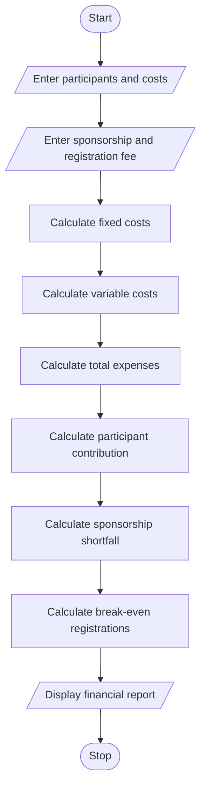

## 1. Problem Statement
Campus Event Financial Planning: Calculate venue, equipment, catering, transport, and certificate costs; determine participant contributions, sponsorship shortfalls, and the minimum registration count needed to break even. 


## 2. Algorithm

1. Start the program.
2. Enter the expected number of participants.
3. Enter venue, equipment, and transport costs.
4. Enter catering and certificate costs per participant.
5. Enter sponsorship amount and registration fee.
6. Calculate fixed costs.
7. Calculate variable costs.
8. Calculate total event expenses.
9. Calculate the required participant contribution.
10. Calculate sponsorship shortfall or surplus.
11. Calculate the minimum registrations needed to break even.
12. Display the financial report.
13. Stop.

## 3. Flowchart 




## 4. Sample Input

```text
Enter expected participants: 100

Enter venue cost: 12000
Enter equipment cost: 5000
Enter transport cost: 3000

Enter catering cost per participant: 150
Enter certificate cost per participant: 30

Enter sponsorship amount: 8000
Enter registration fee per participant: 250
```

## 5. Sample Output

```text
------ EVENT FINANCIAL REPORT ------

Fixed Cost: 20000.0
Variable Cost per Participant: 180.0
Total Variable Cost: 18000.0
Total Event Cost: 38000.0

Required Contribution per Participant: 300.0

Registration Income: 25000.0
Sponsorship Amount: 8000.0
Sponsorship Shortfall: 5000.0

Minimum Registrations for Break-even: 172
Event Loss: 5000.0

------------------------------------
```


